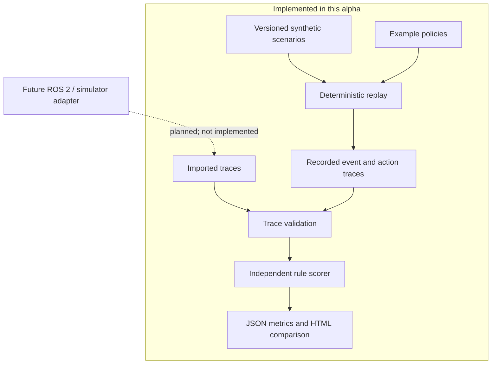

<div align="center">
<h1>RelatioBench</h1>
<p><strong>Replay the interaction. Inspect the decision.</strong></p>
<p>A local workbench for reproducible interaction-policy checks.</p>
</div>

[](https://github.com/ImanCognitiveArch/relatiobench/actions/workflows/ci.yml)
[](pyproject.toml)
[](LICENSE)
[](CHANGELOG.md)
[](docs/RELEASE.md)

**Focus:** authored interaction scenarios for HRI research and virtual role-play.
**Start here:** [comparison report](docs/demo/index.html) · [recorded CLI run](docs/assets/transcript.md) · [contract](docs/CONTRACT.md)

## Architecture at a glance



The two built-in contexts share this core. No ROS 2 node, Gazebo connection,
patient model, emotion inference or physical robot control is implemented.
External systems can export the documented trace format for scoring.

A local Python workbench for replaying authored interaction scenarios and comparing observed policy behavior. The alpha includes a social-robot activity and a virtual role-play fixture, an independent trace scorer, and a self-contained HTML comparison.

**Status:** core acceptance passed on local Linux/Python 3.12 and Windows/Python 3.11 + 3.14; six CI jobs passed on Linux/Windows × Python 3.11/3.12/3.14. Licensed under Apache-2.0. This is an engineering alpha; public-index publication is tracked separately.

## Try the verified local artifact

Python 3.11 or newer. Install the supplied wheel in a virtual environment:

```sh
python -m pip install ./relatiobench-0.1.0a1-py3-none-any.whl
relatiobench demo --output ./demo-output
```

Open `demo-output/index.html`. There are no runtime dependencies, network calls, LLM keys, ROS installation or GPU requirements. The demo writes two scenarios × three policies as JSON traces and scores, plus a comparison report. Built-in fixtures are deterministic; the seed is retained in the run contract for future policies, not used as evidence of stochastic simulation.

The future public-index install command will be documented after an actual release; do not install a similarly named unrelated package.

## What the comparison reveals

| Policy | Behavior | Expected result on both fixtures |
| --- | --- | --- |
| `respectful` | Wait for explicit consent, honor pause, require explicit resume, cap scene level, terminate on withdrawal | Zero rule violations; 2/2 eligible tasks completed |
| `faulty` | Deliberately ignore controls and scene-level bounds | Three violations: paused action, excessive level, action after withdrawal |
| `always_stop` | Emit stop on every event | Zero violations, 0/2 eligible tasks completed |

The last baseline matters: a policy that does nothing can avoid these violations while failing every permitted task. Completion and constraint adherence are separate metrics.

## Recorded evidence

[Recorded CLI transcript](docs/assets/transcript.md) · [raw asciicast](docs/assets/demo.cast) · [generated HTML report](docs/demo/index.html). These files come from an actual installed CLI run using synthetic fixtures. The CLI recording is not a browser screen recording or a physical robot demonstration.

## Your own scenario or trace

```sh
relatiobench validate scenario.json
relatiobench run scenario.json --policy respectful --seed 7 --output trace.json
relatiobench score trace.json --output score.json
```

`score` evaluates recorded actions independently of the policy's identity or implementation. External policies can export the documented trace format; they do not need to run inside this package. Exit codes: `0` valid and passing, `1` valid trace with rule violations, `2` invalid input or file error. A demo containing deliberately faulty runs exits `0` when report generation succeeds.

## Public contract and reproducibility

See [CONTRACT.md](docs/CONTRACT.md) for event/action schemas, tie ordering, metrics and boundaries; [ARCHITECTURE.md](docs/ARCHITECTURE.md) for responsibilities; [REPRODUCE.md](docs/REPRODUCE.md) for verification.

Canonical trace and metric results are repeatable for the same engine/scorer/scenario/policy versions and seed. Setup/runtime duration is recorded separately and excluded from equality. SHA256 is a consistency checksum, not authentication, signing or an immutable log.

## Scope

Events are authored synthetic fixtures, not simulated patients or predictions of human response. Levels are scene parameters. Results do not establish therapeutic effectiveness, empathy, diagnostic validity or physical robot safety. No participant data are included. `REQUEST_REVIEW` only records an event; it does not contact a person or provide monitoring.

The core is headless. A ROS 2 adapter is a separate integration task; simulator, immersive VR and physical actuation are not implemented in this alpha. No private UniversalMind code or dependency is included. VetoLatch remains a separate product.

## Development

```sh
python -m pip install -e .
python -m unittest discover -s tests -v
python -m build
```

Build tooling is a development dependency; the installed package has no third-party runtime dependency. See [CONTRIBUTING.md](CONTRIBUTING.md) and [CHANGELOG.md](CHANGELOG.md).

## Evaluation request

Run one fixture, inspect a flagged action, and tell us which workflow or failure mode the trace misses. Use the friction-report issue template in this repository. Independent use and commercial demand remain unmeasured.

Iman Khorami · Psychology undergraduate, research collaborator, and developer of psychology-focused and cognitive-architecture software.

## License

Copyright 2026 Iman Khorami. Licensed under [Apache-2.0](LICENSE); see [NOTICE](NOTICE).
